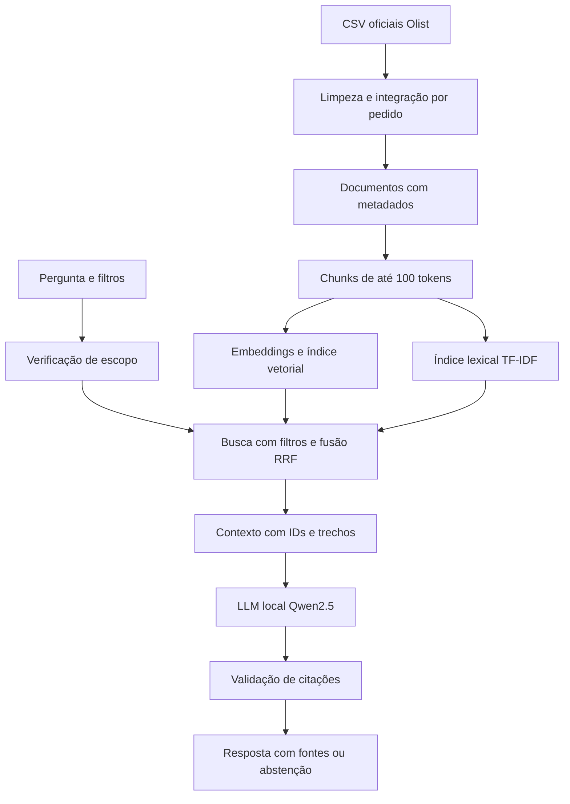

# Escuta — Voice of Customer Intelligence com RAG

**Tech Challenge · Fase 4 · Pós Tech IAST**  
**Aluna: Viviane Demarchi**

Investigue avaliações reais da Olist em português, com recuperação híbrida, filtros de contexto, geração local e citações verificáveis. Cada resposta mostra a avaliação que a sustenta. Perguntas fora do escopo, sem evidência ou que exigem estatística populacional recebem uma explicação da limitação.

> Dados históricos, de 2016 a 2018. A aplicação não representa a operação atual da Olist. O resultado de uma busca não mede a frequência de temas em toda a base.

## Documentação e evidências

- Código completo: `src/voc/`, interface `app.py` e `tests/`.
- Auditoria executada na base oficial: `evidence/data_audit.json`.
- Comparação de recuperação e protocolo: `evaluation/` e `evidence/retrieval_metrics.json`.
- Execuções reais de perguntas e respostas: `evidence/demo_runs.json`.
- Arquitetura e escolhas: `docs/ARQUITETURA.md`.
- Correspondência com briefing: `docs/MATRIZ_REQUISITOS.md`.
- Limitações e resultados: `docs/AVALIACAO.md`.

## Problema de negócio

Gestores de e-commerce precisam investigar motivos de insatisfação, qualidade percebida e aspectos elogiados em milhares de comentários. Notas ajudam a recortar o universo, mas o texto explica a experiência. O Escuta reduz o esforço de localizar relatos e mantém rastreabilidade: o gestor pode ler a evidência, conferir nota, data, pedido e categoria, e questionar a síntese gerada.

## Arquitetura



## Instalação e execução

Referência: Python 3.12, CPU, sem chave de API. Internet é necessária para instalar dependências e baixar dados/modelos. Depois desses downloads, recuperação e geração rodam localmente. Reserve alguns GB de disco e preferencialmente 8 GB ou mais de RAM. O tempo depende do computador; não há requisito de GPU.

### 1. Ambiente Python

No terminal, dentro da pasta do projeto:

```powershell
py -3.12 -m venv .venv
.\.venv\Scripts\python.exe -m pip install --upgrade pip
.\.venv\Scripts\python.exe -m pip install -e ".[test]"
```

Linux/macOS: substitua `.\.venv\Scripts\python.exe` por `.venv/bin/python` e crie o ambiente com `python3 -m venv .venv`.

### 2. Dados e índice

```powershell
.\.venv\Scripts\python.exe -m voc.cli download
.\.venv\Scripts\python.exe -m voc.cli prepare
.\.venv\Scripts\python.exe -m voc.cli index
```

O download utiliza o endpoint público oficial do Kaggle. Se houver exigência de login ou indisponibilidade, baixe o ZIP em https://www.kaggle.com/datasets/olistbr/brazilian-ecommerce e coloque estes quatro CSVs em `data/raw/`:

- `olist_order_reviews_dataset.csv`
- `olist_orders_dataset.csv`
- `olist_order_items_dataset.csv`
- `olist_products_dataset.csv`

O primeiro comando `index` baixa o modelo de embeddings. Depois que os downloads e a indexação terminarem, você pode definir `$env:HF_HUB_OFFLINE="1"` no PowerShell para usar somente o cache local durante a aplicação. Não interrompa a indexação. Ela é feita uma única vez por versão dos dados/modelo. O manifesto registra hashes dos dados e vetores; mudanças exigem reconstrução.

### 3. Modelo de linguagem local

**Caminho mais simples no Windows: Ollama.** Instale a aplicação oficial em https://ollama.com/download, mantenha-a aberta e execute:

```powershell
ollama pull qwen2.5:3b
```

O backend padrão se conecta a `http://localhost:11434/api/chat`. Nenhuma chave de API é necessária. O modelo tem 3 bilhões de parâmetros e é quantizado para execução local em CPU; revisar a qualidade continua necessário.

**Alternativa usada na validação deste projeto: llama.cpp via Python.** Ela pode exigir ferramentas de compilação quando não houver wheel compatível:

```powershell
.\.venv\Scripts\python.exe -m pip install "llama-cpp-python==0.3.36" --extra-index-url https://abetlen.github.io/llama-cpp-python/whl/cpu
.\.venv\Scripts\python.exe scripts/download_model.py
$env:VOC_LLM_BACKEND="llamacpp"
$env:VOC_GGUF_PATH=(Resolve-Path "models/qwen2.5-3b-instruct-q4_k_m.gguf").Path
```

Não é preciso instalar as duas alternativas. A API Ollama está implementada, mas as execuções de geração incluídas foram feitas no backend llama.cpp; isso está distinguido na avaliação.

### 4. Abrir a interface

```powershell
.\.venv\Scripts\python.exe -m streamlit run app.py
```

Abra o endereço local exibido no terminal. Escolha as notas e outros filtros, escreva a pergunta e clique em **Investigar avaliações**. Expanda as fontes e exporte a investigação em JSON.

### 5. Reproduzir validações

```powershell
.\.venv\Scripts\python.exe -m pytest -q
.\.venv\Scripts\python.exe scripts/evaluate_retrieval.py
.\.venv\Scripts\python.exe scripts/run_demo.py
```

A avaliação usa os julgamentos em `evaluation/qrels.json`; não apague esse arquivo para reproduzir a comparação. O script de demonstração exige o LLM funcionando. Os testes unitários usam exemplos sintéticos, separados das evidências reais.

## Base de conhecimento

A ingestão encontrou **99.224 registros de avaliação**. Após excluir **56.537 sem título e sem comentário**, restaram **42.687 documentos**, associados a **42.540 pedidos**. Não houve chaves/notas inválidas nem linhas inteiramente duplicadas nessa versão.

- Título e comentário são unidos quando ambos existem; título isolado é preservado.
- HTML e espaços redundantes são tratados; acentos, negações e pontuação são preservados.
- Ausência de texto não é preenchida com texto artificial ou com a nota.
- Email, telefone e CPF reconhecíveis por padrões são mascarados. Isso **não constitui anonimização completa**: nomes, endereços e identificadores fora dos padrões ainda podem existir.
- `review_id` não é único: 317 ocorrências repetidas entre os documentos elegíveis. Um `doc_id` derivado de avaliação, pedido e posição no arquivo mantém a rastreabilidade.
- Textos iguais de pedidos diferentes não são apagados da base; são deduplicados apenas no contexto recuperado para não desperdiçar espaço.
- Itens e categorias são agregados por pedido antes da integração, evitando multiplicação de avaliações.
- Pedidos com múltiplas categorias mantêm uma lista. O comentário é sobre o pedido, sem atribuição causal a um produto específico.
- Entrega atrasada compara **datas**, não o horário com uma estimativa à meia-noite. Datas ausentes permanecem desconhecidas.

## Pipeline RAG e decisões

1. **Pergunta:** normalização de espaços; limite de 1.000 caracteres e verificação de escopo. O texto não passa por expansão generativa que possa alterar o sentido.
2. **Chunks:** até 100 tokens do tokenizer do modelo, com sobreposição de 20; modelo tem janela de 128 tokens. Isso preserva o fim de comentários longos sem truncamento silencioso.
3. **Embeddings:** `sentence-transformers/paraphrase-multilingual-MiniLM-L12-v2`, 384 dimensões, suporte a português, vetores normalizados. Nenhum treinamento ou fine-tuning foi realizado.
4. **Armazenamento:** JSONL dos documentos e chunks; matriz NumPy float32. Busca exata por produto interno equivale ao cosseno após normalização. Para dezenas de milhares de comentários, evita infraestrutura extra e perda de recall de um índice aproximado.
5. **Busca lexical:** TF-IDF com unigramas e bigramas. Complementa a busca semântica para termos específicos.
6. **Filtros:** nota, data da compra, categoria e situação de atraso aplicados **antes** do ranking. Notas são um recorte operacional, não um classificador perfeito de sentimento.
7. **Fusão:** RRF (`1 / (60 + posição)`), até 60 candidatos por ranking; a soma combina posições sem tratar TF-IDF e cosseno como escalas equivalentes.
8. **Seleção:** até seis avaliações distintas e textos não repetidos; piso de similaridade semântica 0,30. É uma heurística inicial, não probabilidade calibrada de relevância.
9. **Geração:** Qwen2.5 3B Instruct quantizado Q4_K_M, temperatura zero; recebe somente os trechos selecionados como evidências, com IDs.
10. **Memória:** no backend llama.cpp, o modelo de embeddings é liberado antes da geração, e cada chamada do LLM roda em um processo isolado, encerrado após retornar seu JSON. Isso reduz o pico de memória, ao custo de recarregar pesos nas próximas perguntas.
11. **Validação:** saída JSON, até três achados e schema dinâmico que limita os pares ID/citação às evidências recuperadas. A validação posterior também confere pertencimento e literalidade. Falhas resultam em abstenção. Uma segunda chamada ao LLM verifica individualmente se cada achado responde à relação perguntada e é sustentado pela citação; só os índices aprovados são mantidos; essa verificação é falível e não equivale a avaliação independente. Falha de infraestrutura é mostrada como erro, não como resposta de negócio.

O prompt instrui o modelo a ignorar instruções dentro dos comentários. Isso reduz, mas não elimina, risco de prompt injection. Validar uma citação comprova sua existência, **não prova automaticamente que toda a síntese é sustentada por ela**.

## Perguntas sugeridas

- O que os clientes relatam sobre atrasos na entrega? (notas 1 e 2)
- Quais relatos mencionam produtos quebrados ou danificados? (notas 1 e 2)
- Quais elogios se referem à entrega antes do prazo? (notas 4 e 5)
- Clientes receberam um produto diferente do que compraram?
- O que os clientes relatam sobre a entrega por drones? (ausência de evidência)
- Como foi a entrega em 2026? (período fora da base)
- Qual o percentual de clientes com atrasos? (exige agregação, não top-k)

As respostas efetivamente obtidas, incluindo recusas, estão em `evidence/demo_runs.json`. Não há exemplos fictícios apresentados como saída real.

## Limites, segurança e evolução

A base contém viés de quem decidiu escrever; notas não substituem interpretação do texto. A cobertura do vocabulário na regra de escopo é limitada e pode rejeitar perguntas válidas. A regra temporal é conservadora. O piso de similaridade requer calibração mais ampla. O LLM pequeno pode omitir evidências ou gerar inferências inadequadas mesmo citando corretamente. Consultas amplas não garantem diversidade suficiente de temas.

A avaliação é pequena e assistida por IA, não um benchmark validado por especialistas independentes. Não há alegação de acurácia geral ou uso pronto em produção. Próximos passos: ampliar perguntas e anotadores, calibrar abstenção, testar reranker multilíngue e usar classificação temática com agregação para frequências globais. Recomendações de negócio devem ser verificadas antes de orientar decisões.

Telemetria opcional do Hugging Face e Streamlit é desativada. Dados e pesos são baixados de fontes públicas; comentários não são enviados a uma API generativa externa no caminho padrão local. A interface foi projetada para uso local; não oferece autenticação ou autorização multiusuário.

## Licenças e atribuição

Dados: Olist, **Brazilian E-Commerce Public Dataset by Olist**, Kaggle, https://www.kaggle.com/datasets/olistbr/brazilian-ecommerce, licença indicada na origem **CC BY-NC-SA 4.0**. Uso acadêmico não comercial. Trechos de avaliações e derivados permanecem sujeitos à licença dos dados; não se presume permissão para exploração comercial.

Modelos: MiniLM multilíngue (Apache-2.0) e Qwen2.5-3B-Instruct-GGUF (Qwen Research License), conforme seus model cards. Os pesos não são redistribuídos neste repositório. Consulte `docs/REFERENCIAS.md`.

## Regerar o relatório complementar

O PDF não é necessário para executar a aplicação. Para regerá-lo no ambiente Linux de referência, instale o extra `.[report]`, tenha as fontes DejaVu em `/usr/share/fonts/truetype/dejavu/` e execute `python scripts/build_report.py` após produzir o índice e as evidências. A aplicação e o guia de execução não dependem dessas fontes.
